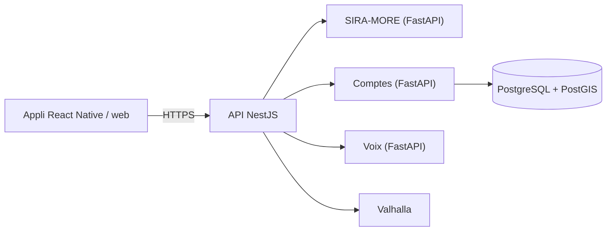

# SIRA — On trace, sans stress

SIRA aide les voyageurs du Grand Abidjan à choisir et à suivre leur trajet en combinant **bus SOTRA, gbaka,
wôrô-wôrô, bateau-bus, taxi et marche**, selon le prix, le temps et le confort. Chaque recherche range les trajets en
trois catégories : **Coulé** (le moins cher), **Debout** (le juste milieu) et **Suspendu** (le plus confortable).
SIRA guide ensuite le voyageur étape par étape, à la voix et sur une carte en 3D, et les voyageurs se partagent les
incidents et les bons coins de la ville.

SIRA se veut la **couche « comment y aller » de Max it** (Orange) : Max it dit *quoi* (une pharmacie de garde, un
service), SIRA dit *comment y aller*. Connexion par numéro **Orange (07)** et code SMS.

- **Essayer en ligne** : <https://16-16-129-62.sslip.io> (serveur de test AWS)
- **Code** : GitHub `Guy277/SIRA_MVP`, branche **`SIRA`**
- **En bref** (produit, technologies, chiffres) : [docs/resume-sira.md](docs/resume-sira.md)

---

## Sommaire

1. [Essayer SIRA sur son téléphone](#1-essayer-sira-sur-son-téléphone)
2. [Ce que fait SIRA](#2-ce-que-fait-sira)
3. [Comment SIRA est construite](#3-comment-sira-est-construite)
4. [Lancer SIRA sur son ordinateur](#4-lancer-sira-sur-son-ordinateur)
5. [Tester sur un téléphone pendant le développement](#5-tester-sur-un-téléphone-pendant-le-développement)
6. [Mettre à jour le serveur en ligne (AWS)](#6-mettre-à-jour-le-serveur-en-ligne-aws)
7. [Où modifier quoi](#7-où-modifier-quoi)
8. [Vérifier que tout marche](#8-vérifier-que-tout-marche)
9. [Données](#9-données)
10. [Limites actuelles](#10-limites-actuelles)
11. [Nouveautés récentes](#11-nouveautés-récentes)
12. [Équipe et documentation](#12-équipe-et-documentation)

---

## 1. Essayer SIRA sur son téléphone

Ouvrir **<https://16-16-129-62.sslip.io>** dans le navigateur du téléphone. Aucune installation n'est nécessaire.

| Téléphone | Navigateur conseillé | L'ajouter comme une appli |
| --- | --- | --- |
| iPhone | **Safari** | Partager (carré avec une flèche) → **Sur l'écran d'accueil** → Ajouter |
| Android (Samsung, Tecno, Infinix, Pixel…) | **Chrome à jour** | Menu ⋮ → **Ajouter à l'écran d'accueil** (ou « Installer l'appli ») |

- L'icône SIRA ouvre alors l'appli en plein écran, sans la barre du navigateur.
- **Connexion** : numéro Orange (07) puis code à 6 chiffres. Le serveur de test est en **mode démo** : le code
  s'affiche à l'écran, sans SMS. Ne pas diffuser le lien largement.
- **Pendant le chargement**, un écran noir avec le logo SIRA et « Chargement de SIRA… » s'affiche. Les ouvertures
  suivantes sont presque immédiates : le téléphone garde les fichiers de l'appli.
- **Après une mise à jour**, fermer complètement SIRA (balayer vers le haut, puis faire glisser SIRA vers le haut)
  avant de la rouvrir. Sinon l'iPhone peut garder l'ancienne version en mémoire.
- **Navigateur trop ancien** (avant Chrome 85, août 2020) : SIRA l'affiche clairement et propose de mettre à jour
  Chrome ou d'ouvrir le lien dans Firefox ou Safari, au lieu d'une page blanche.
- **Éviter le navigateur intégré** de WhatsApp ou Facebook : ouvrir le lien dans Chrome ou Safari, qui donnent accès
  au GPS, au micro et à l'ajout sur l'écran d'accueil.
- Les anciens **BlackBerry** (BlackBerry 10, BlackBerry OS) ne sont plus pris en charge par leur fabricant depuis le
  4 janvier 2022 ; les BlackBerry récents tournent sous Android et ouvrent SIRA comme un Android.

---

## 2. Ce que fait SIRA

### Trouver un trajet

| Fonction | Ce qu'elle fait |
| --- | --- |
| Recherche d'itinéraire | Départ (« Ma position » ou un lieu) et arrivée, lieux proposés pendant la saisie, choix d'un point sur la carte, départ maintenant ou à une heure choisie |
| Coulé / Debout / Suspendu | Les trajets classés par **SIRA-MORE** (le moteur de SIRA), avec durée et prix estimés ; filtres par mode (wôrô, gbaka, bus, taxi, bateau) |
| Détail d'un trajet | Chaque étape : où marcher, où attendre, quelle ligne prendre, ce qui est écrit sur le véhicule, où descendre, combien payer |
| Favoris et historique | Les trajets favoris et les trajets faits, gardés sur le téléphone |

### Être guidé

| Fonction | Ce qu'elle fait |
| --- | --- |
| Carte en 3D qui suit le voyageur | Penchée et tournée dans le sens de marche, le voyageur dans le bas de l'écran, la route devant lui (comme Google Maps) |
| « Recentrer » | Faire glisser la carte la met en pause sans l'aplatir ; un bouton **Recentrer** apparaît, et la carte revient seule sur le trajet après 8 secondes sans toucher. Zoomer à deux doigts ne coupe pas le suivi |
| Vue selon l'étape | À pied : proche et penchée ; à l'arrêt : centrée ; en véhicule : un peu plus loin, et de plus en plus proche à l'approche de l'arrêt |
| Compte à rebours d'arrêts | « Descends dans 3 arrêts », puis « Ton arrêt est le prochain », puis « C'est ton arrêt » ; en mètres quand les arrêts ne sont pas connus (wôrô-wôrô, arrêts informels) ; « Tu arrives dans… » en taxi |
| Alerte pour descendre | « Prépare-toi » quand le prochain arrêt est le bon, à la voix, avec une vibration quand le téléphone le permet |
| Vue d'ensemble | Tout le trajet à plat, par son bouton seulement |
| Arrivée | « Te voilà à… », puis le prix payé, partagé pour les prochains voyageurs |

L'étude de Google Maps, Citymapper, Transit, Moovit et des autres applis qui a guidé ces choix, avec ses sources :
[docs/etude-guidage-carte.md](docs/etude-guidage-carte.md).

### Partager ce qui se passe en ville

| Fonction | Ce qu'elle fait |
| --- | --- |
| Signalements d'incidents | Accident, embouteillage, route bloquée, inondation, route dégradée, véhicule en panne… Confirmés ou contestés par les autres voyageurs (« Toujours là ? ») ; un incident confirmé sur le trajet propose un détour |
| Carte Trafic | Les incidents en direct autour du voyageur, avec sa position |
| Zones suivies | Le voyageur suit des quartiers et est prévenu des incidents qui s'y produisent |
| Calques de la carte | Fond Plan, Nuit ou Épuré, bâtiments en 3D, lignes SIRA, 2D / 3D, boussole |

### Les lieux du quotidien

| Fonction | Ce qu'elle fait |
| --- | --- |
| Catégories sur la carte | Autour de moi, Saveurs du coin, Pharmacies de garde, Points Orange, Marchés, Écoles, Mosquées, Églises, Santé ; les 5 plus proches avec le résumé de leur vrai trajet ; fiche et **Y aller** |
| Pharmacies de garde | Tour de garde de la semaine (UNPPCI), badge « De garde », bouton **Appeler** pour celles sans position |
| Lieux signalés par les voyageurs | Un voyageur signale un lieu absent des cartes (la vendeuse d'alloco du carrefour) avec la position, le moment où c'est ouvert, des étiquettes (« Bien fait », « Pas cher »…), le prix vu et un commentaire |
| Les preuves, pas d'affirmation | SIRA n'affirme jamais qu'un tel lieu existe : la fiche montre combien de personnes le confirment, les « encore là » et « plus là » de la semaine, les voyageurs **arrivés avec SIRA** qui l'ont trouvé (« Tu l'as trouvé ? » à l'arrivée), et une étiquette : Signalé, Confirmé par plusieurs voyageurs, Vérifié récemment |
| Garde-fous | Un compte = une voix ; « C'est bien celui-ci ? » si un lieu semblable existe à moins de 50 m ; effacé sans confirmation pendant 30 jours ; masqué après 3 signalements de contenu ; le commerçant peut demander à être retiré ; jamais de pharmacie ni de santé |
| Lien pour Max it | `siraproj://y-aller?lat=…&lng=…&nom=…` ouvre directement l'itinéraire vers un lieu |

Détails, règles et seuils : [docs/lieux.md](docs/lieux.md) ; scénario de démo : [docs/demo-lieux.md](docs/demo-lieux.md).

### Parler à SIRA

| Fonction | Ce qu'elle fait |
| --- | --- |
| Assistant vocal | On parle, SIRA comprend le français d'Abidjan, calcule le trajet et répond à voix haute ; « il y a un accident à… » prépare un signalement |
| La voix de SIRA | Une seule voix partout, « pierre », activée par défaut (« Akwaba » dès le premier toucher), avec un dictionnaire de prononciation des lieux d'Abidjan |
| Discuter avec SIRA | Le même assistant à l'écrit : compagnon de route qui conseille et explique, sans rien inventer ([docs/assistant-compagnon.md](docs/assistant-compagnon.md)) |
| FAQ | Réponses écrites à l'avance, une fiche par question (`services/voice/knowledge/`) |

### Le compte du voyageur

Profil avec photo, autorisations (position, micro), réglages des notifications, confidentialité et suppression du compte,
déconnexion, partage de SIRA. Tout ce qui est personnel (favoris, historique, zones suivies) reste sur le téléphone.

---

## 3. Comment SIRA est construite



L'appli ne parle qu'à l'API ; les autres services restent privés derrière elle.

| Partie | Technologie | Dossier | Port local |
| --- | --- | --- | --- |
| Appli | **React Native avec Expo** (SDK 58, Expo Router), TypeScript ; une seule base de code pour iPhone, Android et le web. Carte web : **MapLibre** ; carte de l'appli installée : **react-native-maps** | `mobile/` | 8081 |
| API | **NestJS** (Node.js, TypeScript) : seule porte d'entrée de l'appli (trajets, signalements, lieux, comptes, voix) | `services/api/` | 4000 |
| Moteur de trajets | **SIRA-MORE**, Python **FastAPI** : classe les trajets Coulé / Debout / Suspendu | `services/engine/` | 8000 |
| Comptes | Python **FastAPI** + SQLAlchemy : code SMS Orange, sessions, prix payés | `services/community/` | 8100 |
| Assistant vocal | Python **FastAPI** : Whisper (écoute), CamemBERT (compréhension), Piper « pierre » (voix), Ministral 3 3B (LLM local, en renfort) | `services/voice/` | 8200 |
| Base de données | **PostgreSQL 17 + PostGIS 3.5** | `infra/database/` | |
| Autour | Valkey (cache), Valhalla (routes à pied et en voiture), Nginx et Caddy (portes d'entrée web, HTTPS, compression), Docker / Podman | `infra/` | |

Toute l'IA tourne **en local**, sans service payant en ligne : la voix des voyageurs ne quitte pas le serveur.

```text
SIRA/
├── mobile/              L'APPLI : écrans (app/), composants, logique (lib/), tests (tests/)
│   └── public/          page web d'entrée : écran de chargement, manifeste, icônes de l'écran d'accueil
├── services/
│   ├── api/             porte d'entrée : trajets, signalements, lieux, comptes, voix
│   ├── engine/          SIRA-MORE : classement Coulé / Debout / Suspendu
│   ├── community/       comptes (code SMS Orange) et prix des voyageurs
│   ├── voice/           assistant vocal fr-CI + FAQ (knowledge/)
│   └── models/          modèles d'IA (hors Git, voir models/README.md)
├── data/                données de transport et lieux (325 lignes du Grand Abidjan)
├── infra/               compose.yaml, Nginx, Caddy (HTTPS), base PostGIS, page de suivi du serveur
├── scripts/             lancer la stack, mettre à jour le serveur, installer la voix, outils de données
├── tests/               tests des données de transport et des lieux
└── docs/                documentation, études, cahier des charges, travail sur la voix
```

Règles du projet : l'appli ne parle qu'à `services/api` ; rien de lourd ni de secret dans Git (modèles, données,
`.env`, bases) ; **aucune donnée inventée** : chaque chiffre affiché vient d'une source ou d'un calcul écrit.

Détails : [docs/architecture.md](docs/architecture.md) (services, API, sécurité) et
[docs/architecture-aws.md](docs/architecture-aws.md) (le serveur en ligne).

---

## 4. Lancer SIRA sur son ordinateur

Prérequis : **Node.js 22** et **Python 3**. Une seule commande lance tout (SIRA-MORE, comptes, voix, API et appli) :

```bash
npm install
npm install --prefix mobile   # la première fois seulement
npm run dev:stack
```

Sous Windows, on peut aussi double-cliquer sur `LANCER_SIRA_WINDOWS.bat`.

- **Navigateur** : `http://localhost:8081`.
- **L'appli déjà lancée à part** (`npx expo start` dans `mobile/`) ? La stack la détecte et ne la relance pas
  (`SIRA_MOBILE=false` pour ne jamais la lancer).
- **L'assistant vocal** démarre s'il est installé (`npm run voice:setup`, une fois).
- **Les lieux du quotidien** viennent de `data/lieux/lieux.json` : `npm run data:lieux` le fabrique (voir
  [docs/lieux.md](docs/lieux.md)).
- **Connexion** : numéro Orange (07) puis code à 6 chiffres. En développement, le code s'affiche à l'écran, sans SMS.
- Les signalements, confirmations et lieux signalés par les voyageurs sont gardés dans `services/api/runtime/`
  (hors Git) d'un redémarrage à l'autre.

**Position de démo** (pour une démo sans GPS, à Abobo) :

```powershell
$env:EXPO_PUBLIC_SIRA_POSITION_DEMO="5.4410,-4.0090"; npm run dev:stack
```

---

## 5. Tester sur un téléphone pendant le développement

Pour une démo ou un essai simple, utiliser plutôt le **site en ligne** (partie 1). Pour tester une modification
pas encore en ligne, `npm run dev:stack` affiche l'adresse à ouvrir sur le téléphone et prévient de ce qui bloquerait :

```text
[SIRA] Sur téléphone (même Wi-Fi, Wi-Fi) : http://192.168.x.x:8081
[SIRA] Test API depuis le téléphone : http://192.168.x.x:4000/api/v1/health
[SIRA] Micro et GPS : HTTPS nécessaire -> npm run dev:tunnel, ou l'appli Expo Go (QR code)
```

1. **Même Wi-Fi** pour le PC et le téléphone. Certains Wi-Fi (école, hôtel, box en mode invité) isolent les
   appareils entre eux : utiliser alors le **partage de connexion du téléphone** pour le PC.
2. **Pare-feu Windows**, une seule fois : PowerShell **en administrateur**, puis
   `powershell -ExecutionPolicy Bypass -File scripts\windows\autoriser-telephone.ps1`.
   Il ouvre les ports 8081 et 4000 **uniquement en profil Privé et pour le réseau local**, et propose de passer
   le réseau en **Privé** (ne le faire que sur un réseau de confiance). Pour tout retirer :
   `scripts\windows\retirer-regles-telephone.ps1`.
3. **VPN** : le désactiver sur le PC et sur le téléphone pendant les tests.
4. Ouvrir d'abord `http://<IP>:4000/api/v1/health` sur le téléphone : si ça ne répond pas, le souci est réseau
   (pare-feu, Wi-Fi isolé, VPN), pas l'appli.
5. **Micro et GPS** : Safari et Chrome ne les donnent qu'en **HTTPS** (ou sur `localhost`). Pour les tester :
   `npm run dev:tunnel` (HTTPS, voir ci-dessous) ou **Expo Go**.

| Où | Adresse | Écrans et trajets | Micro | « Ma position » (GPS) |
| --- | --- | --- | --- | --- |
| Navigateur du PC | `http://localhost:8081` | ✅ | ✅ | ✅ |
| Navigateur du téléphone | `http://<IP>:8081` | ✅ | ❌ (HTTPS requis) | ❌ (HTTPS requis) |
| Navigateur du téléphone | tunnel `https://…trycloudflare.com` | ✅ | ✅ | ✅ |
| Expo Go (QR code) | appli installée | ✅ | ✅ | ✅ |
| Site en ligne | `https://16-16-129-62.sslip.io` | ✅ | ✅ | ✅ |

**Tunnel HTTPS** (`npm run dev:tunnel`, avec `npm run dev:stack` déjà lancé) : installer une fois
`winget install Cloudflare.cloudflared`. Le script ouvre un tunnel vers l'API et vers l'appli, et affiche l'adresse
à ouvrir. **Le PC est accessible depuis Internet tant que le terminal est ouvert** (Ctrl+C ferme tout) ; ne pas
partager le lien : en développement, le code SMS s'affiche à l'écran.

**Expo Go** (l'appli installée, avec la carte react-native-maps) : il faut un Expo Go qui gère le SDK du projet.
Hors du Wi-Fi du PC, `npx expo start --tunnel` (sous Windows, ajouter `$env:NODE_PATH = "$env:APPDATA\npm"` avant).
Si la connexion mobile du PC bloque le tunnel d'Expo, utiliser le partage de connexion ou le site en ligne.

Si `mobile/.env` contient `EXPO_PUBLIC_API_URL`, l'appli appelle cette adresse au lieu du PC : `dev:stack` le signale.

---

## 6. Mettre à jour le serveur en ligne (AWS)

Le serveur de test est une machine AWS (EC2 t3.large, Stockholm) où tous les services tournent dans des conteneurs,
derrière Caddy (HTTPS automatique Let's Encrypt) puis Nginx. Procédure complète, accès et points d'attention :
[docs/serveur-test-aws.md](docs/serveur-test-aws.md).

Depuis le PC, `npm run server:update` n'envoie que les fichiers modifiés, puis relance seulement ce qui doit l'être :

```bash
npm run server:update -- api          # code de l'API, reconstruite (Nginx redémarré ensuite, sinon erreur 502)
npm run server:update -- web          # appli web (mobile/dist), à exporter avant, voir ci-dessous
npm run server:update -- infra        # Caddy, Nginx, compose : relance de la stack
npm run server:update -- api web --dry-run   # montre ce qui partirait, sans rien envoyer
```

Autres cibles : `engine`, `community`, `voice`, `models`, `data`, `all`. `infra/server.env` (les secrets du serveur)
n'est jamais envoyé.

**Exporter l'appli web** avant `server:update -- web` (PowerShell, depuis `mobile/`) :

```powershell
$env:EXPO_PUBLIC_API_URL = "https://16-16-129-62.sslip.io/api/v1"
$env:NODE_OPTIONS = "--max-old-space-size=6144"   # l'export manque de mémoire si la stack locale tourne
npx expo export -p web
```

Ce que le serveur fait pour que l'appli s'ouvre vite sur tous les téléphones :

- **Compression** zstd ou gzip par Caddy : environ 4 fois moins à télécharger (Nginx ne compresse pas ce qui passe
  par Caddy, à cause de l'en-tête « Via »).
- **Cache** : les fichiers dont le nom change à chaque export (`/_expo`, `/assets`) sont gardés un an par le
  téléphone ; la page d'entrée est redemandée à chaque ouverture, pour que les mises à jour arrivent toujours.
- **Premier écran sans attendre les polices** : le texte s'affiche dans la police du téléphone puis passe en Montserrat.

Après une mise en ligne, penser à fermer complètement SIRA sur le téléphone avant de tester.

---

## 7. Où modifier quoi

| Je veux changer… | Fichier(s) |
| --- | --- |
| Un écran de l'appli | `mobile/app/` (un fichier par écran) |
| L'appel à l'API depuis l'appli | `mobile/lib/sira-api.ts` (seul point d'accès) |
| La connexion, la session | `mobile/lib/session.ts`, `mobile/lib/use-otp-login.ts`, `services/community/` |
| Le calcul des trajets | `services/api/src/mobility/` (graphe : `transport-graph.ts`) |
| Le classement Coulé / Debout / Suspendu | `services/engine/app/engine.py` (SIRA-MORE) |
| L'écran du guidage | `mobile/app/navigation-active.tsx` |
| Ce que SIRA dit pendant le trajet, quand elle le dit (GPS) | `mobile/lib/guidance.ts` |
| Le compte à rebours d'arrêts, la vue de la carte par étape | `mobile/lib/ride-progress-core.ts` (testé dans `mobile/tests/ride-progress.test.mjs`) |
| La carte web (suivi 3D, Recentrer, calques) | `mobile/components/osm-map-view.web.tsx`, `mobile/components/map-layers-sheet.tsx` |
| La carte de l'appli installée | `mobile/components/osm-map-view.tsx` ; calculs partagés : `mobile/components/osm-map-types.ts` |
| Les signalements d'incidents | `services/api/src/reports/`, `mobile/lib/reports.ts`, `mobile/app/report-event*.tsx` |
| Les catégories de lieux, les pharmacies de garde | `scripts/import-lieux.mjs`, `services/api/src/lieux/`, `mobile/components/lieux-*.tsx`, `mobile/app/lieu.tsx` |
| Les lieux signalés par les voyageurs (règles, seuils) | `services/api/src/lieux/lieux-voyageurs.ts`, `mobile/app/signaler-lieu.tsx` |
| « Tu l'as trouvé ? » à l'arrivée | `mobile/lib/lieu-vise.ts`, `mobile/app/navigation-active.tsx` |
| L'assistant vocal (compréhension, réponses) | `services/voice/app/` (`dialog.py` pour les phrases de réponse) |
| La prononciation des lieux | `services/voice/knowledge/dictionnaire.csv` |
| Les réponses de la FAQ | `services/voice/knowledge/*.md` (une fiche par question, voir `services/voice/knowledge/README.md`) |
| L'écran « Discuter avec SIRA » | `mobile/app/chat.tsx` |
| La confidentialité, la suppression de compte | `mobile/app/privacy.tsx`, `services/community/app/main.py` |
| La police Montserrat | `mobile/components/sira-text.tsx`, chargée dans `mobile/app/_layout.tsx` |
| L'écran de chargement, le message « navigateur trop ancien », l'icône d'écran d'accueil | `mobile/public/index.html`, `mobile/public/manifest.json` |
| La compression, le cache, le HTTPS du serveur | `infra/Caddyfile`, `infra/nginx/nginx.conf` |
| Les modèles d'IA (voix) | `services/models/voice/` (hors Git, voir `services/models/README.md`) |

---

## 8. Vérifier que tout marche

```bash
npm test                                   # données de transport et lieux
npm --prefix services/api test             # API : trajets, signalements, lieux, lieux des voyageurs (122 tests au 23 novembre 2026)
npm --prefix mobile test                   # appli : compte à rebours, carte, favoris, historique… (48 tests au 23 novembre 2026)
npx --prefix mobile tsc --noEmit -p mobile # typage de l'appli
npm run test:ai                            # SIRA-MORE (services/engine)
npm run test:community                     # comptes, suppression de compte, codes SMS
npm run test:voice                         # assistant vocal (sans les gros modèles)
npm run test:runtime                       # l'API appelle bien SIRA-MORE, de bout en bout
```

---

## 9. Données

- **Réseau de transport** : données ouvertes data.gouv.ci (2021), actualisées avec OpenStreetMap
  ([docs/transport-osm.md](docs/transport-osm.md)). Durées, attentes et tarifs restent des **estimations** à valider
  avec les opérateurs.
- **Lieux du quotidien** : OpenStreetMap et Overture Maps, fusionnés sans doublons (7 425 lieux au 8 novembre 2026),
  plus les lieux signalés par les voyageurs.
- **Pharmacies de garde** : tour de garde de l'UNPPCI, lu chaque jour, avec une copie de secours.
- **Règle du projet** : aucune donnée inventée ; chaque chiffre affiché vient d'une source ou d'un calcul écrit.

---

## 10. Limites actuelles

- **Moteur** : SIRA-MORE propose souvent le taxi, « Debout » est souvent vide, et il ne propose jamais la marche pour
  un lieu tout proche.
- **Connexion** : serveur de test en mode démo SMS (code affiché à l'écran) en attendant les accès Orange Developer.
- **Serveur** : un seul serveur, sans sauvegarde automatique, adresse provisoire (`sslip.io`).
- **Guidage** : le compte à rebours d'arrêts n'a pas encore été éprouvé pendant un vrai trajet en bus ou en gbaka ;
  le retour automatique après 8 secondes est un réglage à confirmer à l'usage.
- **Appli installée** (Expo, react-native-maps) : le guidage en 3D y est codé mais n'a pas encore tourné sur un
  téléphone ; sur iPhone, la distance de la carte vient d'une approximation à régler.
- **Lieux signalés par les voyageurs** : seuils proposés (50 m, 7 jours, 30 jours, 3 signalements) à valider par
  l'équipe ; gardés dans un fichier JSON, pas encore dans PostGIS ; pas encore de photos.
- **Connexion lente** : les icônes peuvent apparaître quelques secondes comme de petits carrés, le temps que leurs
  polices arrivent.
- **Navigateurs** : il faut au moins Chrome 85 (août 2020) ou un Safari équivalent ; les Android antérieurs à 7.1.1
  ne font pas confiance au certificat Let's Encrypt du serveur (Firefox contourne ce problème).

---

## 11. Nouveautés récentes

Novembre 2026, du plus récent au plus ancien (détail dans l'historique Git de la branche `SIRA`) :

- **Ouverture rapide sur tous les téléphones** : compression du serveur, écran de chargement, message pour les
  navigateurs trop anciens, premier écran sans attendre les polices, fichiers gardés un an par le téléphone.
- **Guidage en 3D** : la carte reste penchée quand on la touche, « Recentrer » et retour automatique, compte à rebours
  d'arrêts, alerte pour descendre, vue selon l'étape, aussi dans l'appli installée ; étude de l'existant sourcée.
- **Lieux signalés par les voyageurs**, avec leurs preuves, et « Tu l'as trouvé ? » à l'arrivée.
- **Plus de flash** « Aucun trajet en cours » en quittant le guidage.
- **Voix** : « pierre » partout, activée par défaut, vitesse 1,0, dictionnaire de prononciation des lieux.
- **Carte** : Calques (Plan, Nuit, Épuré, bâtiments 3D, lignes SIRA), 2D / 3D, boussole.
- **Appli selon les maquettes** : écran des trajets en trois blocs, barre du bas, menu latéral, Profil, photo de
  profil, zones suivies, parcours « Signaler un événement », écrans adaptés à toutes les tailles.
- **De vraies données** à la place d'exemples inventés : historique des trajets et favoris gardés sur le téléphone.
- **SIRA compagnon** dans « Discuter avec SIRA ».

---

## 12. Équipe et documentation

| Partie | Auteur | Dossier |
| --- | --- | --- |
| Application mobile (maquette validée) | Banatou | `mobile/` |
| Moteur de trajets, signalements | Achille | `services/api`, `services/engine` |
| Comptes SMS Orange, tarifs communautaires | Abraham (logique reprise sans ses secrets) | `services/community` |
| Assistant vocal (dataset fr-CI, modèles, service) | Achille | `services/voice` |

| Document | Contenu |
| --- | --- |
| [docs/resume-sira.md](docs/resume-sira.md) | SIRA en bref : produit, technologies, données, déploiement |
| [docs/architecture.md](docs/architecture.md) | Services, ports, API, moteur, sécurité |
| [docs/architecture-aws.md](docs/architecture-aws.md) | Le serveur en ligne : services, trajet d'une demande, stockage |
| [docs/serveur-test-aws.md](docs/serveur-test-aws.md) | Installer et mettre à jour le serveur de test |
| [docs/lieux.md](docs/lieux.md) | Lieux du quotidien, pharmacies de garde, lieux signalés par les voyageurs |
| [docs/demo-lieux.md](docs/demo-lieux.md) | Scénario de démo de 2 minutes |
| [docs/etude-guidage-carte.md](docs/etude-guidage-carte.md) | Étude de l'existant sur la carte pendant le guidage, et les lots 1 à 3 |
| [docs/assistant-compagnon.md](docs/assistant-compagnon.md) | « Discuter avec SIRA » comme compagnon de route |
| [docs/plan-ia-locale.md](docs/plan-ia-locale.md) | Voix ivoirienne, modèles et LLM local |
| [services/voice/README.md](services/voice/README.md) | Assistant vocal : installation, modèles, API, limites |
| [services/models/README.md](services/models/README.md) | Modèles d'IA : lesquels, où, comment les changer |
| [docs/README.md](docs/README.md) | Toute la documentation : cahier des charges, audits de données, PostGIS, voix |
| [mobile/README.md](mobile/README.md) | L'application mobile |

L'ancien site web (port 3001) et le dossier `archive/` ont été retirés ; ils restent consultables dans l'historique Git.
