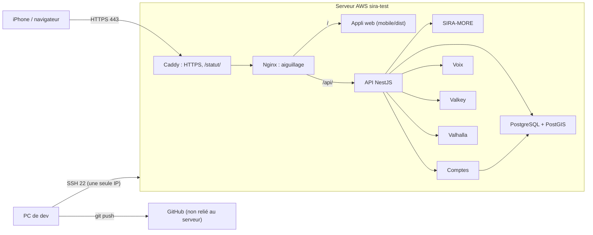

# Architecture du serveur de test sur AWS

Comment SIRA tourne sur le serveur de test, et où chaque chose est rangée. Installation et mises à jour :
[serveur-test-aws.md](serveur-test-aws.md). Relevé sur le serveur le 2026-11-08.

## Vue d'ensemble

Tout tourne sur **un seul serveur**, `sira-test` (EC2 t3.large : 2 processeurs, 8 Go de mémoire, Stockholm),
découpé en conteneurs Docker, un par service (`infra/compose.yaml` + `infra/compose.server.yaml`).

## Le trajet d'une demande

1. **Caddy** est la seule porte publique (80 et 443). Il obtient seul le certificat HTTPS (Let's Encrypt) pour
   `SIRA_DOMAIN` (aujourd'hui `16-16-129-62.sslip.io`) et protège `/statut/` par un mot de passe (`infra/Caddyfile`).
2. **Nginx** (`infra/nginx/nginx.conf`) envoie `/api/` à l'API et sert tout le reste depuis `mobile/dist` (l'appli web
   compilée) ; il limite les demandes par adresse. La page n'est jamais gardée en cache par le navigateur
   (`Cache-Control: no-cache`), les scripts de `_expo/` si.
3. **L'API NestJS** est le seul service joint depuis l'extérieur. Elle appelle, sur le réseau privé des conteneurs :
   SIRA-MORE (Coulé / Debout / Suspendu), les comptes (code SMS, session), la voix (Whisper, Piper).
4. **Derrière**, jamais joignables depuis Internet : PostgreSQL + PostGIS (comptes), Valkey (cache), Valhalla
   (itinéraires à pied et en voiture sur la carte OpenStreetMap de la Côte d'Ivoire).

Le serveur n'est **pas** relié à GitHub : un `git push` ne met pas le serveur à jour, et le serveur ne lit jamais
GitHub. Les mises à jour partent du PC avec `npm run server:update -- <cible>` (seuls les fichiers modifiés partent,
puis le conteneur du service est reconstruit).

## Où est stocké quoi

Un seul disque : **40 Go** (EBS gp3), dont 18 Go utilisés et 21 Go libres le 2026-11-08.

### Le projet : `/home/ubuntu/sira` (1,8 Go)

Copie des fichiers du projet envoyés depuis le PC, **sans l'historique Git**.

| Dossier | Taille | Contenu |
| --- | --- | --- |
| `services/models/voice/` | 1,45 Go | Modèles de la voix : compréhension `sira_models_v0.4` (852 Mo), Whisper (464 Mo), Piper (134 Mo) |
| `data/` | 270 Mo | Réseau de transport (`abidjan-master`, `processed`, `osm-2026`, `LigneArete`) et lieux (`data/lieux`, 3,7 Mo) |
| `mobile/dist/` | quelques Mo | Appli web compilée, servie par Nginx |
| `services/`, `infra/`, `scripts/` | petit | Code des services, configuration du serveur |
| `infra/server.env` | — | Secrets du serveur (mot de passe de la base, `SIRA_DOMAIN`…). Lisible par root seulement, **jamais dans Git** |

Les données et les modèles ne sont pas dans Git (trop lourds) : ils existent sur le PC et sur le serveur seulement.

### Les données qui changent : volumes Docker, `/var/lib/docker/volumes/`

| Volume | Taille | Contenu | Perdu, est-ce grave ? |
| --- | --- | --- | --- |
| `sira-mvp_postgres_data` | 80 Mo | Comptes des voyageurs, codes SMS, prix signalés | **Oui** : ne se recrée pas |
| `sira-mvp_api_runtime` | < 1 Mo | Signalements des voyageurs (`reports.json`) et réponses « Encore là ? » (`lieux-confirmations.json`), monté sur `/app/runtime` de l'API | Oui pour les réponses ; les signalements expirent seuls (45 min à 7 jours) |
| `sira-mvp_valhalla_data` | 409 Mo | Carte routière préparée pour Valhalla | Non : se reconstruit (environ 20 min) |
| `sira-mvp_voice_cache` | < 1 Mo | Cache de la voix | Non |
| `sira-mvp_valkey_data` | < 1 Mo | Cache de l'API | Non |
| `sira-mvp_caddy_data`, `_config` | < 1 Mo | Certificat HTTPS | Non : redemandé à Let's Encrypt |

### Les programmes : images Docker (8,5 Go)

Les services construits (API, SIRA-MORE, comptes, voix) et les logiciels téléchargés (Nginx, Caddy, PostgreSQL,
Valhalla, Valkey). S'y ajoute un cache de construction (5,2 Go, dont 4,9 Go récupérables avec
`sudo docker builder prune` si le disque se remplit).

### Le suivi : `/var/lib/sira-status/`

Mesures de la page `/statut/` (`status.json`), écrites chaque minute par `scripts/server/status.py` (cron).

## Points à corriger avant de vrais utilisateurs

Corrigé le 2026-11-08 : les signalements et les réponses « Encore là ? » étaient effacés à chaque reconstruction de
l'API (ancien `infra/compose.yaml` sur le serveur, sans le volume `api_runtime`). Le volume est en place, et un
fichier écrit dans `/app/runtime` a été retrouvé après un redémarrage de l'API.

- **Aucune sauvegarde.** Tout est sur un seul disque. À activer dans la console AWS : sauvegardes automatiques du
  disque (instantanés EBS, via Data Lifecycle Manager), quelques centimes par mois pour ces tailles.
- **Un seul serveur** : s'il s'arrête, tout s'arrête.
- **Mode démo SMS** (`SIRA_ENV=development`) : le code de connexion s'affiche à l'écran.
- **Voix moins complète que sur le PC** : ni LLM local, ni Parakeet (Whisper seul).
- **Adresse provisoire** `sslip.io` : pour une vraie mise en ligne, un nom de domaine (par exemple `sira.ci`).
