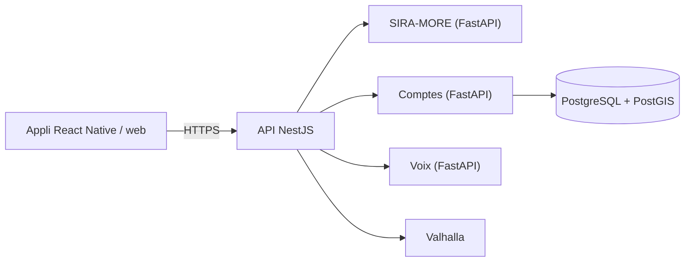

# SIRA en bref

*On trace, sans stress.* Résumé du projet au 2026-11-08 (branche `SIRA`).

## Le produit

SIRA aide les voyageurs du Grand Abidjan à choisir leur trajet en combinant **bus SOTRA, gbaka, wôrô-wôrô,
bateau-bus, taxi et marche**. Chaque recherche donne trois catégories :

- **Coulé** : le moins cher ;
- **Debout** : le juste milieu (seulement s'il apporte vraiment quelque chose face aux deux autres) ;
- **Suspendu** : le plus confortable.

Pour chaque trajet : la décomposition étape par étape (où marcher, où attendre, quelle ligne prendre, où descendre,
combien payer), puis un guidage pas à pas, avec les incidents signalés par les voyageurs.

SIRA se veut la **couche « comment y aller » de Max it** (Orange) : Max it dit *quoi* (une pharmacie de garde, un
service), SIRA dit *comment y aller*. Connexion par numéro Orange (07) et code SMS.

## Fonctionnalités

| Fonction | Ce qu'elle fait |
| --- | --- |
| Recherche d'itinéraire | Départ (position ou lieu) et arrivée, lieux proposés pendant la saisie, choix sur la carte |
| Coulé / Debout / Suspendu | Classement des trajets par SIRA-MORE, durées et prix estimés |
| Détail et guidage | Étapes, arrêts, lignes, prix ; suivi GPS, annonces vocales, « prépare-toi à descendre » |
| Signalements | Accident, bouchon, route bloquée, inondation… confirmés par les autres voyageurs (« toujours là ? ») ; détour proposé autour d'un incident confirmé |
| Lieux du quotidien | Rangée de catégories sur la carte : Autour de moi, Saveurs du coin, Pharmacies de garde, Points Orange, Marchés, Écoles, Mosquées, Églises, Santé ; liste des 5 plus proches avec leur trajet ; fiche et « Y aller » |
| Pharmacies de garde | Tour de garde UNPPCI de la semaine, badge « De garde », bouton « Appeler » pour celles sans position |
| Assistant vocal | On parle, SIRA comprend le français d'Abidjan, calcule le trajet et répond à voix haute ; FAQ ; « il y a un accident à… » prépare un signalement |
| Discuter avec SIRA | Le même assistant, à l'écrit |
| Lien pour Max it | `siraproj://y-aller?lat=…&lng=…&nom=…` ouvre directement l'itinéraire vers un lieu |

## Technologies

| Partie | Technologie | Dossier |
| --- | --- | --- |
| Appli (front-end) | **React Native avec Expo** (SDK 58, Expo Router), TypeScript ; une seule base de code pour iPhone, Android et le web | `mobile/` |
| API (back-end principal) | **NestJS** (Node.js, TypeScript) : seule porte d'entrée de l'appli | `services/api/` |
| Moteur de trajets | **SIRA-MORE**, Python **FastAPI** : classe les trajets Coulé / Debout / Suspendu | `services/engine/` |
| Comptes | Python **FastAPI** + SQLAlchemy : code SMS Orange, sessions, prix signalés | `services/community/` |
| Assistant vocal | Python **FastAPI** : Whisper (écoute), CamemBERT (compréhension), Piper « pierre » (voix), Ministral 3 3B (LLM local, en renfort) | `services/voice/` |
| Base de données | **PostgreSQL 17 + PostGIS 3.5** (données géographiques) | `infra/database/` |
| Autour | Valkey (cache), Valhalla (routes à pied et en voiture), Nginx et Caddy (portes d'entrée web), Docker | `infra/` |

Toute l'IA tourne **en local**, sans service payant en ligne : la voix des voyageurs ne quitte pas le serveur.

## Données

- **Réseau de transport** : données ouvertes data.gouv.ci (2021), actualisées avec OpenStreetMap (octobre 2026).
  Durées, attentes et tarifs restent des **estimations** à valider avec les opérateurs.
- **Lieux du quotidien** : 7 425 lieux (OpenStreetMap et Overture Maps, fusionnés sans doublons), répartis sur les
  13 communes du Grand Abidjan.
- **Pharmacies de garde** : tour de garde de l'UNPPCI, lu chaque jour, avec une copie de secours.
- **Règle du projet** : aucune donnée inventée ; chaque chiffre affiché vient d'une source ou d'un calcul écrit.

## Architecture

L'appli ne parle qu'à l'API ; les autres services restent privés derrière elle. Détails :
[architecture.md](architecture.md) et [architecture-aws.md](architecture-aws.md).

## Déploiement

- **En local** : `npm run dev:stack` lance tout ; l'appli s'ouvre dans le navigateur ou dans Expo Go.
- **En ligne** : un serveur AWS (EC2 t3.large, Stockholm), tous les services dans des conteneurs Docker, HTTPS
  automatique : <https://16-16-129-62.sslip.io>. Sur iPhone, « Sur l'écran d'accueil » l'ouvre comme une appli.
- **Code** : GitHub (`Guy277/SIRA_MVP`, branche `SIRA`) ; le serveur se met à jour depuis le PC
  (`npm run server:update`).

## Qualité

Environ **325 tests automatiques**, tous au vert le 2026-11-08 : données (13), API (109), appli (23),
SIRA-MORE (43), comptes (21), voix (116). Typage de l'appli et de l'API sans erreur.

## Limites actuelles

- **Recommandations du moteur** : SIRA-MORE propose souvent le taxi ; « Debout » est souvent vide ; jamais la marche
  pour un lieu tout proche.
- **Données fictives** encore affichées dans le détail d'une alerte d'accident (l'historique et les favoris montrent
  désormais les vrais trajets, gardés sur le téléphone seulement).
- **Mode démo SMS** : le code de connexion s'affiche à l'écran, en attendant les accès Orange Developer.
- **Serveur unique, sans sauvegarde automatique**, et adresse provisoire (`sslip.io`).
- **Appli testée dans le navigateur au format téléphone** ; la version Expo Go reste à éprouver sur de vrais téléphones.

## En une phrase

*SIRA est une appli React Native (Expo) qui trouve le meilleur trajet multimodal dans le Grand Abidjan, avec une API
NestJS, des services d'IA et de calcul en Python (FastAPI), une base PostgreSQL avec PostGIS, et un assistant vocal
qui tourne en local, le tout dans des conteneurs Docker sur AWS.*
